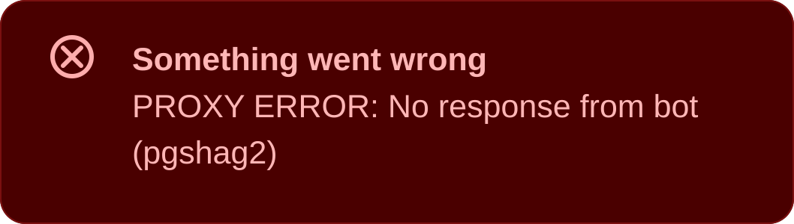

# Using JanitorAI with NanoGPT

A quick guide to connecting JanitorAI chats to NanoGPT's API.

## Setup Instructions

1. Get your API key from [nano-gpt.com/api](https://nano-gpt.com/api)
2. In JanitorAI, open **API Settings**
3. Select **Proxy** as the provider
4. Click **+ Add** under **Proxy Configurations**
5. Configure the proxy with the following values:

   ```text
   Configuration Name: any label, e.g. NanoGPT
   Model Name: Model ID, e.g. auto-model-basic
   Proxy URL: https://nano-gpt.com/api/v1/chat/completions
   API Key: <your NanoGPT API key>
   ```

6. Click **Apply**, then make sure the NanoGPT proxy configuration is marked **Active**

JanitorAI now routes your conversations through NanoGPT.

<Note>
Use `nano-gpt.com` here, not `api.nano-gpt.com`. JanitorAI's app sends NanoGPT requests through JanitorAI's own servers, and those can't reach `api.nano-gpt.com`, even though it works on the website. The `nano-gpt.com` address works in both, with the same key, models and prices.
</Note>

## Available Models

`auto-model-basic` automatically selects a model included in your subscription. To use a specific model instead, copy its exact current model ID from the [NanoGPT pricing page](https://nano-gpt.com/pricing).

## Include Reasoning

If you want JanitorAI to include reasoning output for reasoning-capable models, duplicate the configuration above and change the proxy URL to:

```text
https://nano-gpt.com/api/v1thinking/chat/completions
```

## Troubleshooting

If the JanitorAI app shows **PROXY ERROR: No response from bot** like this:

<Frame>
  
</Frame>

check the **Proxy URL** first. It must start with `https://nano-gpt.com`, not `https://api.nano-gpt.com`, because JanitorAI's app can't reach `api.nano-gpt.com`.

If JanitorAI shows a **PROXY ERROR** with a status code, the most common causes are:

- `401`: the API key is wrong or has extra spaces.
- `402`: you used a paid model that is not included in your subscription, and your NanoGPT account has no balance.
- `404`: the model ID is outdated, misspelled, or unavailable. Copy the model's current ID from the [NanoGPT pricing page](https://nano-gpt.com/pricing).

Also re-check that **Proxy URL** is `https://nano-gpt.com/api/v1/chat/completions` or `https://nano-gpt.com/api/v1thinking/chat/completions`.

If replies have missing letters or misspelled words, or repeat the same phrase without stopping, check **Rep. penalty** in JanitorAI's generation settings. 1 turns it off. Values below 1 make the model repeat itself, and on long chats they can produce garbled text and endless loops. If changing it fixes one chat but not another, check the other chat's generation settings too.
